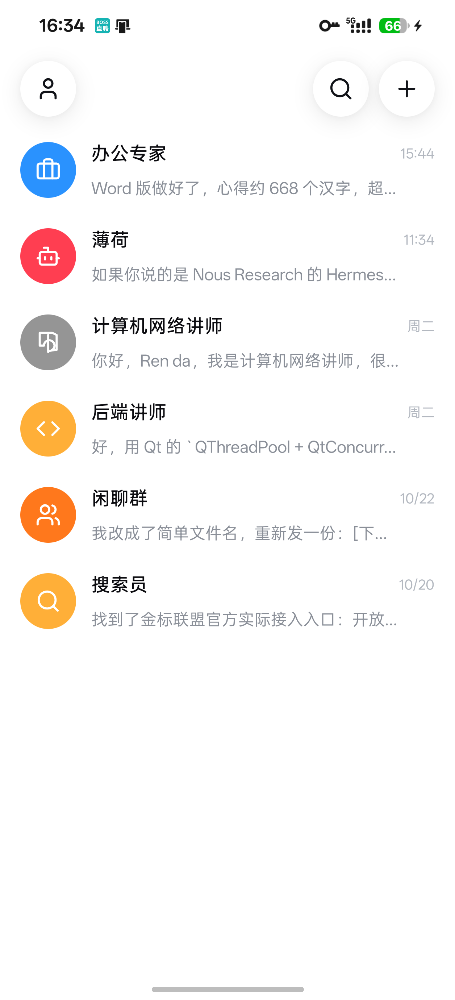

# DSHM Bot

基于 [DeepSeek Harness (DSH)](https://github.com/deepseek-ai/deepseek-harness) 的个人 Agent **原生 Android 客户端**。
界面与产品定位按 Bot 来做（参考 [DS-Bot](https://github.com/Fei2411/DS-Bot)），底层接入 DSH
（参考 [dsh-Go](https://github.com/ccch1mneyyy/dsh-Go) 的引擎与协议实现）。

当前里程碑 **M0：工程化跑通** —— 原生 Compose 主界面（Bot / 群聊列表）、设计令牌、启动图标、
单元测试与插桩测试、可安装 APK。数据层目前是演示实现，真实 DSH / DS Bot 接入在 M1 开始。

<p align="center">
  
</p>

## 技术栈

| 层 | 选型 |
|---|---|
| UI | Kotlin + Jetpack Compose（Material 3），单 Activity |
| 状态 | ViewModel + StateFlow（单向数据流） |
| 数据 | Repository 接口（当前 `DemoBotRepository`；M1 接 DSH HTTP/SSE） |
| 构建 | Gradle 8.14 + AGP 8.11.1 + Kotlin 2.2.20，`compileSdk 36` / `minSdk 26` |
| 测试 | JUnit4（JVM）+ Compose UI Test（插桩）+ Python 图标管线测试 |

## 目录

```
app/                          Android 单模块
  src/main/java/com/dshm/bot/
    core/design/              设计令牌（颜色 / 间距 / 圆角 / 字体 / 主题）
    domain/model/             Bot 模型、DS Bot 颜色算法
    domain/repository/        数据接口（单一数据源）
    data/demo/                M0 演示数据源
    ui/home/                  主界面（列表 / 顶栏 / 搜索 / 新建面板）
    ui/chat/                  Bot 对话占位页
    ui/format/                列表时间戳格式化
  src/test/                   JVM 单元测试
  src/androidTest/            Compose 插桩测试
design/                       图标源文件与裁切产物
tools/                        图标生成脚本与其测试
docs/                         架构、路线图、界面说明
```

## 构建与测试

需要 JDK 17+（推荐 21）与 Android SDK。`local.properties` 里写 `sdk.dir`（不入库）。

```powershell
$env:JAVA_HOME = 'C:\Program Files\Java\jdk-21.0.10'

.\gradlew.bat :app:assembleDebug        # 构建调试 APK
.\gradlew.bat :app:testDebugUnitTest    # JVM 单元测试
.\gradlew.bat :app:lintDebug            # Android Lint
.\gradlew.bat :app:connectedDebugAndroidTest   # 插桩测试（需模拟器/真机）
```

测试覆盖约定：每完成一个功能，至少包含正常路径、边界（空 / 超长 / 未来时间等）、异常路径与回归用例。
详细分层与后续里程碑见 [docs/architecture.md](docs/architecture.md)、[docs/roadmap.md](docs/roadmap.md)。

## 图标

启动图标由 `design/app-icon-source.png` 生成（legacy + adaptive，含圆形变体）：

```powershell
python tools/generate_app_icons.py
python -m unittest discover -s tools -p "test_*.py"
```

生成结果直接写入 `app/src/main/res/mipmap-*`；资源尺寸与清单接线由 `AppIconResourcesTest` 守护。

## 许可

本项目基于 dsh-Go（AGPL-3.0）与 DS-Bot（Apache-2.0）的设计与协议实现二次开发，
以 **AGPL-3.0** 发布。来源与第三方许可见 [THIRD_PARTY_NOTICES.md](THIRD_PARTY_NOTICES.md)。
